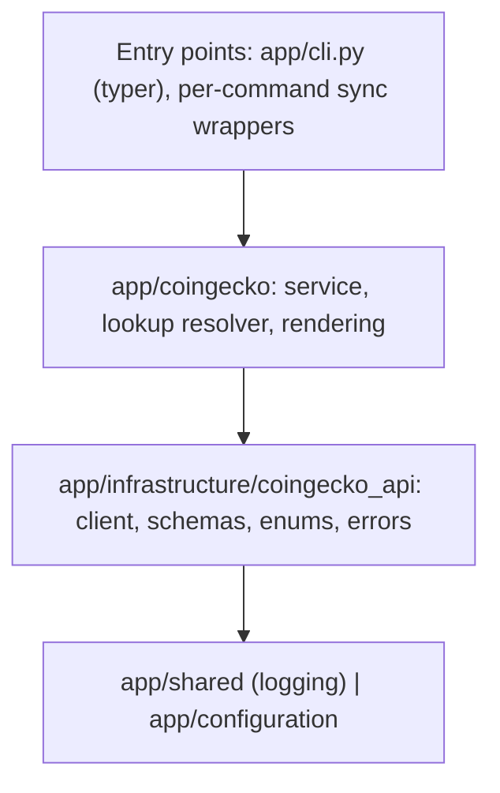

# Architecture

A thin, async Python 3.15 client for the CoinGecko mobile API with a typer CLI, following the same
layers and rules as the 7331 backend template: pydantic everywhere, one domain, one external-API
package, and every process opening its resources once and passing them down.

## Layers



1. `app/infrastructure/coingecko_api/` — the external system's connection package. The client is
   the contract: one method per endpoint, typed keyword-only arguments, typed returns, statuses
   mapped to `CoinGeckoApi*Error` subclasses (`errors.py`). Wire shapes live in `schemas.py`
   (because `schemas.py` means pydantic wire shapes everywhere), closed value sets in `enums.py`,
   base URL / user agent / timeouts / retry counts in `configuration.py`
   (`COINGECKO_API_*`). One `httpx.AsyncClient` per process, opened on the caller's
   `AsyncExitStack`; transport-level connect retries plus `stamina` retries on connection errors,
   429 and 5xx with jittered backoff.
2. `app/coingecko/` — the domain. `service.py` (`CoinGeckoService`) holds the use cases other code
   calls (a Discord bot imports this, not the client): `resolve_coin` and `coin_price_summary`.
   `chart_image.py` renders the dark-theme candlestick PNG that `cg chart` and the Discord bot
   share. `lookup.py` (`CoinResolver`) keeps a top-300 `coins_lite` index on disk
   (`configuration.py`, `COINGECKO_LOOKUP_*`), serves exact id/slug/symbol/name hits, prefix hits,
   `difflib` fuzzy hits and a search-endpoint fallback, and serves stale cache when a refresh fails.
   Read types for callers sit in `types.py`; domain errors in `errors.py`; CLI output formatting in
   `rendering.py`.
3. `app/cli.py` — the typer app. `QueryDefaultingGroup` sends any unknown first token to the
   `price` command, so `cg btc`, `cg bitcvoin --vs eur` and `cg global` all work. Command functions
   are sync wrappers that run their async implementation on uvloop; they build one service per run
   through `composition.py` and either call the service (query commands) or the client (raw
   endpoint commands). Errors surface as a red line and an exit code: 1 network, 2 API, 3 unknown
   coin.

## Conventions kept from the template

- Keyword-only parameters everywhere, one positional subject at most; names long form; no comments
  or docstrings; no `Any`, no `typing.cast`; environment variables only through pydantic-settings
  `configuration.py` modules with `@lru_cache` getters; ruff `ALL` with the template's ignores,
  `ty` strict, deptry, import-linter (`lint-imports`) enforcing the layers above; `prek` runs the
  hooks in `.pre-commit-config.yaml`.
- JSON goes through pydantic (`model_validate_json`, `model_dump_json`, `TypeAdapter`). The CLI's
  `--json` output dumps `by_alias=True`, so it reproduces the wire field names.

## State

The client keeps no state of its own beyond the lookup index cache: one JSON file under the cache
directory (`coin_index.json`, default `~/.cache/coingecko-mobile-api/`) with a TTL
(`COINGECKO_LOOKUP_CACHE_TTL_SECONDS`). Nothing else is persisted; every run talks to the live API.

## E2E

`e2e/run_flows.py` drives the built CLI as a subprocess (HTTP-only, no mocks) through the lookup,
markets, coin and search flows and asserts on parsed `--json` output and exit codes. Run:

```
uv run --project e2e python run_flows.py
```
